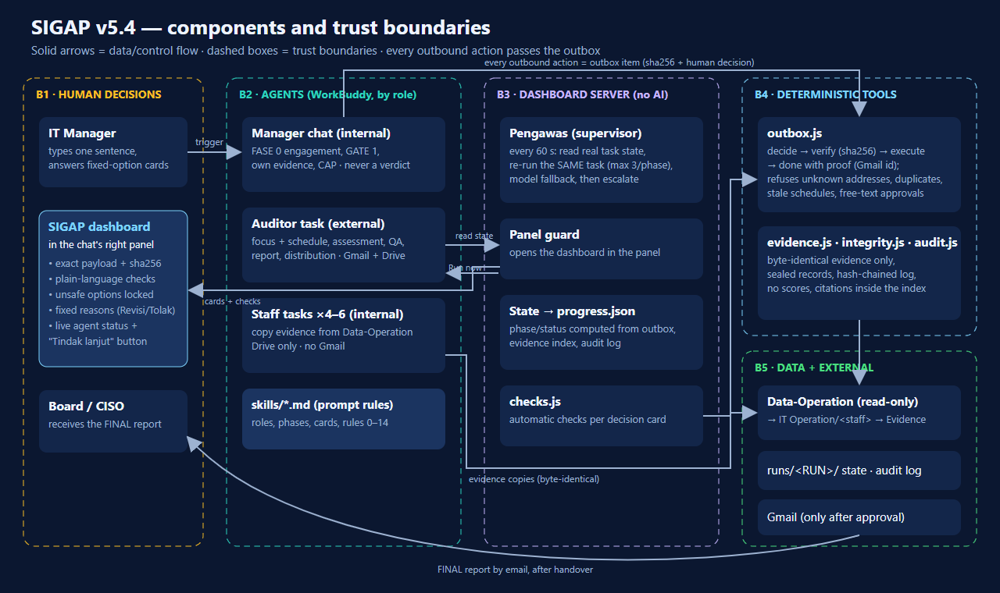

# SIGAP — Architecture

([SVG source](architecture.svg))

## Components

| Component | Where | Role |
|---|---|---|
| **Manager chat** | WorkBuddy conversation `ISO270001-NN Manager` | IT Manager (internal auditee): opens the run, GATE 1, releases its own evidence, accepts the report, owns the CAP. Never assesses. |
| **Auditor task** | WorkBuddy scheduled task, connectors Gmail + Google Drive | External auditor: proposes 3–5 focus items and a schedule, checks completeness, assesses, QA, publishes the report, distributes it to the Board/CISO. |
| **Staff tasks** | WorkBuddy scheduled tasks, connector Google Drive only | IT staff: copy relevant documents byte-identical from Data-Operation into their own folder and request a release per file. |
| **Skills** | `skills/` | Prompt layer: roles, nine phases (FASE 0–8), card catalogue, rules 0–14, task prompt templates. |
| **SIGAP dashboard** | `progress-dashboard/` (`node server.js`, `http://127.0.0.1:4173`) | The only place for human decisions on task-made items; opens itself in the Manager chat's right panel; automatic checks; live agent status. |
| **Pengawas** | inside the dashboard server | Deterministic supervisor: every 60 s reads the real task state from WorkBuddy (`tools/wbstate.js`, read-only), re-runs the same task through WorkBuddy's own "Run now" (max 3 per phase, back-off), switches model when one is saturated (`model-fallback.json`), then creates an escalation card. |
| **Outbox** | `tools/outbox.js`, `runs/<RUN>/outbox/` | Every outbound action is a sealed item: exact payload + sha256 → human decision → `verify` → execute → `done` with proof. |
| **Evidence** | `tools/evidence.js`, `simulation/data-operation-manifest.json` | Only byte-identical copies of Data-Operation documents (hash in the manifest) can be indexed; citations outside the index and numeric scores are rejected. |
| **Integrity / audit** | `tools/integrity.js`, `tools/audit.js` | Sealed records, hash-chained audit log, reserved system actors. |

## Trust boundaries

1. **Human decisions (B1).** A decision is a click on a fixed option — in a chat card or in the dashboard. Free text never approves.
   *Revisi* and *Tolak* carry one fixed reason that is passed to the agent.
2. **Agents by role (B2).** External Auditor vs internal Manager and staff; connectors limited per role (staff have no Gmail).
3. **Dashboard server (B3, no AI).** Shows the exact payload and its hash, checks it in plain language, locks unsafe options, records the
   decision; phase and status are computed from the system state, never from agent prose.
4. **Deterministic tools (B4).** The outbox refuses: addresses outside `data/mock/contacts.json`, duplicate sends, schedules already in
   the past, "sent" without a Gmail message id, report distribution before the handover is accepted, wake tasks made by the Manager after GATE 1.
5. **Data (B5).** Data-Operation is read-only; evidence flows Data-Operation → `IT Operation/<staff>/` → indexed Evidence; state in
   `runs/<RUN>/`; Gmail only after an approved and verified item.

## Key design trade-offs

| Choice | Why | Cost |
|---|---|---|
| Rules that matter are enforced **in code**, not only in prompts | In testing, agents broke prompt rules (run 11: the Manager edited its own guard tool; run 09: a staff task created an out-of-scope automation) | More tooling; some rules (scope, automation) are still prompt-level |
| **Pengawas is server logic, not another agent** | Stalls came from the platform (model saturation, 429), and WorkBuddy recurring tasks run at most hourly; a supervisor that is itself an LLM can stall too | Needs WorkBuddy started with a local debug port so the server can read task state and press "Run now" |
| **Dashboard instead of chat cards for task-made items** | Cards were not rendered inside task sessions (run 08) | A second surface — solved by showing the dashboard inside the Manager chat's right panel |
| **Conformity statuses, no scores** | A number looks more certain than the evidence; ISO audits report conformity | Less "dashboard-friendly" than a percentage |
| **Evidence only from Data-Operation, byte-identical** | Agents must never create or "summarise into" evidence | Missing evidence becomes a clarification card ("Belum tersedia"), not a guess |
| **Separation of duties** (external Auditor issues and sends; Manager never assesses) | Independence of an audit | Two agents and a handover step |
